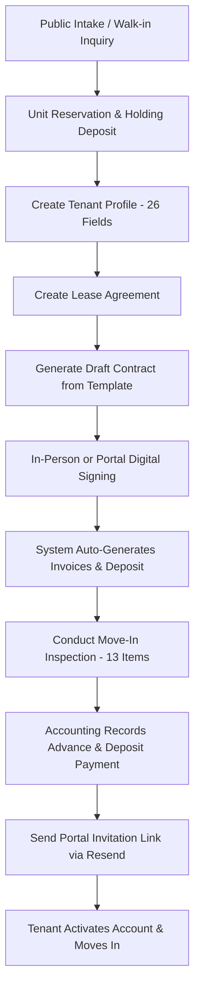
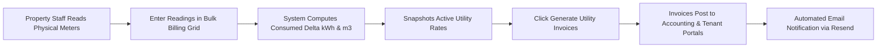
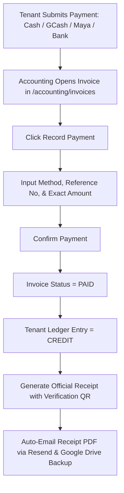
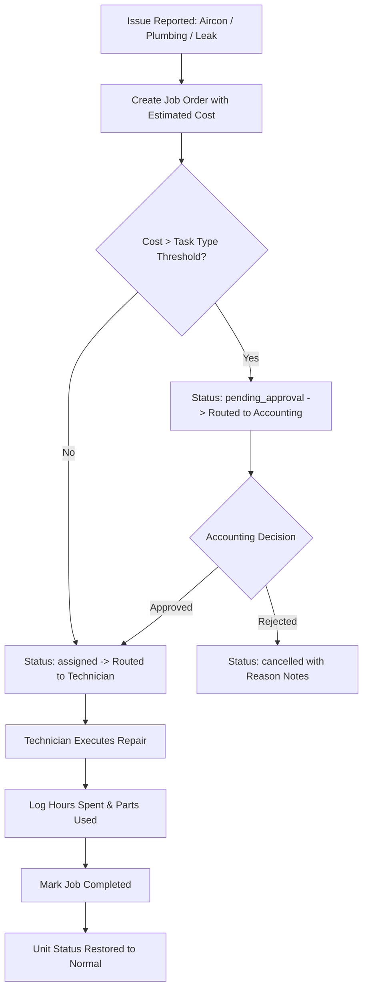
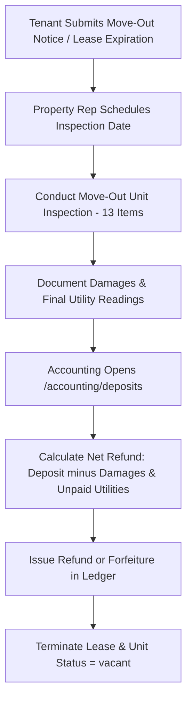
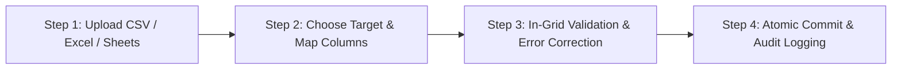
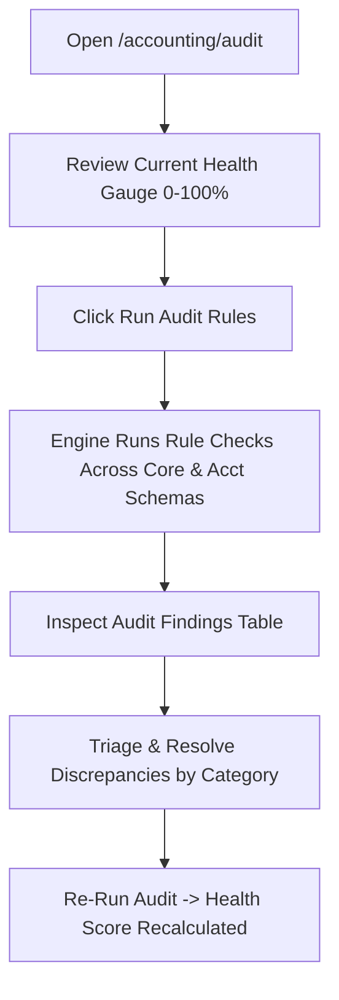

# EVE-CONNECT APARTMENT PORTAL — COMPREHENSIVE USER MANUAL & STANDARD OPERATING PROCEDURES (SOP)
**System:** EVE-CONNECT Apartment Rental Operations Platform (`apartment-portal`)  
**Version:** 2.0 (Production Release)  
**Target Audience:** Property Representatives, Accounting Officers, Maintenance Technicians, Marketing Managers, System Administrators, Executive Leadership, and Tenants.  
**Currency Standard:** Philippine Peso (`₱` / PHP)  
**Metric Standards:** Floor Area ($m^2$), Electric Energy ($kWh$), Water Volume ($m^3$)  

---

## Table of Contents
1. [System Overview & Global Interface Anatomy](#1-system-overview--global-interface-anatomy)
2. [User Roles & RBAC Permission Matrix](#2-user-roles--rbac-permission-matrix)
3. [Master Operational Workflows (End-to-End Lifecycle Procedures)](#3-master-operational-workflows)
   - [Workflow A: Complete Tenant Onboarding Lifecycle](#workflow-a-complete-tenant-onboarding-lifecycle)
   - [Workflow B: Monthly Utility Meter Reading & Billing Cycle](#workflow-b-monthly-utility-meter-reading--billing-cycle)
   - [Workflow C: Payment Collection, Official Receipt (OR) Issuance & Reconciliation](#workflow-c-payment-collection-official-receipt-or-issuance--reconciliation)
   - [Workflow D: Maintenance Ticket & Approval Threshold Lifecycle](#workflow-d-maintenance-ticket--approval-threshold-lifecycle)
   - [Workflow E: Lease Termination, Move-Out Inspection & Deposit Clearance](#workflow-e-lease-termination-move-out-inspection--deposit-clearance)
   - [Workflow F: Legacy Building Data Ingestion Engine (CSV/Excel)](#workflow-f-legacy-building-data-ingestion-engine-csvexcel)
   - [Workflow G: System Compliance Audit & Data Health Remediation](#workflow-g-system-compliance-audit--data-health-remediation)
4. [Step-by-Step Guide for Property Representatives (`property_rep`)](#4-step-by-step-guide-for-property-representatives-property_rep)
   - [4.1 Managing Properties & Buildings](#41-managing-properties--buildings)
   - [4.2 Managing Units & Inventory Status](#42-managing-units--inventory-status)
   - [4.3 Creating & Managing Extended Tenant Profiles (26 Fields)](#43-creating--managing-extended-tenant-profiles-26-fields)
   - [4.4 Creating Leases & Rental Agreements](#44-creating-leases--rental-agreements)
   - [4.5 Contract Template Management & Draft Generation](#45-contract-template-management--draft-generation)
   - [4.6 In-Person Digital Contract Execution (Signature Pad)](#46-in-person-digital-contract-execution-signature-pad)
   - [4.7 Conducting Unit Move-In & Move-Out Inspections (13 Items)](#47-conducting-unit-move-in--move-out-inspections-13-items)
   - [4.8 Inviting Tenants to the Self-Service Portal](#48-inviting-tenants-to-the-self-service-portal)
   - [4.9 Operating the Property Calendar](#49-operating-the-property-calendar)
   - [4.10 Operating the Bulk Import Engine](#410-operating-the-bulk-import-engine)
5. [Step-by-Step Guide for Accounting Staff (`accounting`)](#5-step-by-step-guide-for-accounting-staff-accounting)
   - [5.1 Invoicing Operations (Rent, Utilities, Deposits, Penalties, Add-ons)](#51-invoicing-operations)
   - [5.2 Recording Multi-Method Payments](#52-recording-multi-method-payments)
   - [5.3 Official Receipts & Verification QR Codes](#53-official-receipts--verification-qr-codes)
   - [5.4 Interactive Financial Spreadsheet Operations](#54-interactive-financial-spreadsheet-operations)
   - [5.5 Security Deposit Management, Ledger Entries & Refunds](#55-security-deposit-management-ledger-entries--refunds)
   - [5.6 Approving Maintenance Cost Thresholds](#56-approving-maintenance-cost-thresholds)
   - [5.7 System Compliance Audit Engine & Health Gauge](#57-system-compliance-audit-engine--health-gauge)
   - [5.8 Operating the Accounting Calendar](#58-operating-the-accounting-calendar)
6. [Step-by-Step Guide for Maintenance Staff (`maintenance`)](#6-step-by-step-guide-for-maintenance-staff-maintenance)
   - [6.1 Creating Job Orders & Priority Triage](#61-creating-job-orders--priority-triage)
   - [6.2 Threshold Cost Escalation Handling](#62-threshold-cost-escalation-handling)
   - [6.3 Technician Assignment & Logging Work Hours](#63-technician-assignment--logging-work-hours)
   - [6.4 Completing Job Orders & Closing Tickets](#64-completing-job-orders--closing-tickets)
   - [6.5 Asset & Appliance Tracking (Warranties & Serial Numbers)](#65-asset--appliance-tracking-warranties--serial-numbers)
   - [6.6 Managing Maintenance Task Types & Thresholds](#66-managing-maintenance-task-types--thresholds)
   - [6.7 Operating the Maintenance Calendar](#67-operating-the-maintenance-calendar)
7. [Step-by-Step Guide for Marketing Staff (`marketing`)](#7-step-by-step-guide-for-marketing-staff-marketing)
   - [7.1 Creating & Publishing Unit Listings](#71-creating--publishing-unit-listings)
   - [7.2 Tracking Prospect Leads & Inquiries](#72-tracking-prospect-leads--inquiries)
   - [7.3 Reserving Units & Holding Deposits](#73-reserving-units--holding-deposits)
   - [7.4 Converting Reservations to Leases](#74-converting-reservations-to-leases)
   - [7.5 Unit Availability Forecasting (30/60/90 Days)](#75-unit-availability-forecasting-306090-days)
   - [7.6 Operating the Marketing Calendar](#76-operating-the-marketing-calendar)
8. [Step-by-Step Guide for System Administrators (`system_admin`)](#8-step-by-step-guide-for-system-administrators-system_admin)
   - [8.1 Provisioning Staff Users & Role Assignments](#81-provisioning-staff-users--role-assignments)
   - [8.2 Property Scoping Configuration (Global vs. Assigned Properties)](#82-property-scoping-configuration)
   - [8.3 User Lifecycle Management (Suspend, Reactivate, Password Reset)](#83-user-lifecycle-management)
   - [8.4 System-Wide Audit Log Investigation](#84-system-wide-audit-log-investigation)
   - [8.5 Storage Buckets & File Verification](#85-storage-buckets--file-verification)
9. [Step-by-Step Guide for Executive Leadership (`executive`)](#9-step-by-step-guide-for-executive-leadership-executive)
   - [9.1 Executive Dashboard Key Metric Analysis](#91-executive-dashboard-key-metric-analysis)
   - [9.2 Interactive Revenue & Occupancy Analytics](#92-interactive-revenue--occupancy-analytics)
   - [9.3 Generating & Exporting Portfolio Reports](#93-generating--exporting-portfolio-reports)
10. [Step-by-Step Guide for Tenants (`tenant`) — Self-Service Portal](#10-step-by-step-guide-for-tenants-tenant--self-service-portal)
    - [10.1 Accepting Portal Invitations & Account Setup](#101-accepting-portal-invitations--account-setup)
    - [10.2 Tenant Portal Login & Dashboard Overview](#102-tenant-portal-login--dashboard-overview)
    - [10.3 Reviewing Lease Details & Terms](#103-reviewing-lease-details--terms)
    - [10.4 Digital Contract Signing via Tenant Portal](#104-digital-contract-signing-via-tenant-portal)
    - [10.5 Invoices, Payments & Downloading Official Receipts](#105-invoices-payments--downloading-official-receipts)
    - [10.6 Tracking Utility Consumption](#106-tracking-utility-consumption)
    - [10.7 Submitting Move-Out Notices](#107-submitting-move-out-notices)
    - [10.8 Managing Profile & Emergency Contacts](#108-managing-profile--emergency-contacts)
11. [Public Tenant Application Intake Guide (`/intake`)](#11-public-tenant-application-intake-guide-intake)
    - [11.1 Accessing the Intake Portal](#111-accessing-the-intake-portal)
    - [11.2 Step-by-Step Intake Form Completion](#112-step-by-step-intake-form-completion)
    - [11.3 Staff Processing of Public Submissions](#113-staff-processing-of-public-submissions)
12. [Utility Metering & Per-Property Bulk Billing Engine](#12-utility-metering--per-property-bulk-billing-engine)
    - [12.1 Meter Configuration & Unit Assignment](#121-meter-configuration--unit-assignment)
    - [12.2 Utility Rate Scheduling (Electricity & Water)](#122-utility-rate-scheduling-electricity--water)
    - [12.3 Monthly Batch Reading & Billing Generation](#123-monthly-batch-reading--billing-generation)
13. [Troubleshooting & Frequently Asked Questions](#13-troubleshooting--frequently-asked-questions)
14. [Quick Reference URL Route Map & Shortcuts](#14-quick-reference-url-route-map--shortcuts)

---

## 1. System Overview & Global Interface Anatomy

The **EVE-CONNECT Apartment Rental Operations Platform** is an enterprise property management ecosystem engineered for multi-building residential operations in the Philippines. It unifies operations across seven distinct roles, featuring strict PostgreSQL Row Level Security (RLS), digital canvas contract execution, multi-method payment receipting with QR verification, automated utility delta billing, and a dedicated mobile-friendly tenant portal.

```
+---------------------------------------------------------------------------------------------------+
| TOPBAR: [EVE-CONNECT Logo]  [Property Scope Selector: All / Tower A / ...]  [Search] [Theme] [User] |
+---------------------------------------------------------------------------------------------------+
| SIDEBAR NAV        | MAIN CONTENT WORKSPACE                                                       |
|                    |                                                                              |
| - Dashboard        |  [Breadcrumbs: Property > Leases > LEASE-0042]                                |
| - Property         |  +-------------------------------------------------------------------------+ |
|   - Properties     |  | Page Header: Unit 304 Lease Profile           [+ Edit Lease] [Print]   | |
|   - Units          |  +-------------------------------------------------------------------------+ |
|   - Tenants        |  | STAT CARDS: [Monthly Rent: ₱15,000] [Outstanding: ₱0.00] [Days Left: 184] | |
|   - Leases         |  +-------------------------------------------------------------------------+ |
|   - Contracts      |  | TABS: [Overview] [Invoices (6)] [Payments (6)] [Deposits (1)] [Activity]  | |
|   - Utilities      |  |                                                                         | |
| - Accounting       |  | TAB CONTENT: Active Lease Details, Payment History, Balance Ledger      | |
| - Maintenance      |  +-------------------------------------------------------------------------+ |
| - Marketing        |                                                                              |
| - Admin            |                                                                              |
+--------------------+------------------------------------------------------------------------------+
```

### 1.1 Interface Navigation Anatomy
1. **Property Scope Selector (Topbar):** Filters the displayed data across the active dashboard to a specific property (e.g., `ADI 168`, `KALAYAAN 888`) or displays all managed properties across the portfolio (`All Properties`).
2. **Global Search Bar (Topbar):** Quick-jump search for units, tenants, lease numbers, and invoice numbers.
3. **Theme Switcher:** Toggles between Dark Mode and Light Mode with instant CSS variable re-rendering.
4. **User Profile Dropdown:** Displays the currently authenticated staff member, role badge, assigned scope, and the **Sign Out** button.
5. **Left Sidebar Menu:** Role-tailored collapsible menu. Tabs and sections are automatically restricted based on your role's permissions.
6. **Toast Notification System:** Bottom-right slide-in alerts notifying you of asynchronous operations (e.g., `Payment recorded successfully`, `Contract marked signed`, `Error: Duplicate unit number`).

---

## 2. User Roles & RBAC Permission Matrix

Every user in the system is assigned a designated role. Permissions are strictly enforced both at the server action level (`assertPermission`) and database tier (PostgreSQL RLS policies).

| Role Key | Role Name | Primary Responsibility | Scoping Default |
|---|---|---|---|
| `system_admin` | System Administrator | User provisioning, role assignment, audit logs, system-wide configuration | Global |
| `accounting` | Accounting Officer | Invoicing, payments, official receipts, deposits, spreadsheet, financial audit | Global or Property |
| `property_rep` | Property Representative | Units, tenant profiles, leases, contract signing, inspections, bulk import | Property-specific |
| `maintenance` | Maintenance Staff | Job orders, technician time tracking, asset tracking, maintenance calendar | Global or Property |
| `marketing` | Marketing Officer | Public listings, inquiries, reservations, availability forecasting | Global |
| `executive` | Executive / Director | Revenue analytics, occupancy trends, high-level operational reporting | Global |
| `tenant` | Tenant / Resident | Self-service portal (`/portal`), contract review, utility bills, receipts | Self-scoped (`tenant_id`) |

### Core Permissions Breakdown

| Action / Entity | `system_admin` | `accounting` | `property_rep` | `maintenance` | `marketing` | `executive` | `tenant` |
|---|:---:|:---:|:---:|:---:|:---:|:---:|:---:|
| **Manage Users & Roles** | Yes | No | No | No | No | No | No |
| **View Audit Logs** | Yes | Yes (Audit) | No | No | No | Yes | No |
| **Create Properties & Units** | Yes | No | Yes | No | No | No | No |
| **Create Tenants & Leases** | Yes | No | Yes | No | No | No | No |
| **Execute Contracts** | Yes | No | Yes | No | No | No | Yes (Self) |
| **Issue Invoices & Payments** | Yes | Yes | No | No | No | No | No |
| **Approve Repair Costs** | Yes | Yes | No | No | No | No | No |
| **Create & Update Job Orders**| Yes | No | Yes | Yes | No | No | No |
| **Publish Unit Listings** | Yes | No | No | No | Yes | No | No |
| **Reserve Units** | Yes | No | Yes | No | Yes | No | No |
| **Access Executive Reports** | Yes | Yes | No | No | No | Yes | No |
| **Access Tenant Portal** | No | No | No | No | No | No | Yes |

---

## 3. Master Operational Workflows

### Workflow A: Complete Tenant Onboarding Lifecycle
*Estimated Time: 15–20 minutes*  
*Involved Roles:* `marketing` / `property_rep`, `accounting`, `tenant`



1. **Step 1 — Lead Intake or Reservation:** The prospect either applies through the public portal (`/intake`), is registered via Marketing Inquiries (`/marketing/inquiries`), or reserves a unit with a holding deposit (`/property/reservations`).
2. **Step 2 — Tenant Profile Creation:** Property Representative opens `/property/tenants/new` (or converts the reservation), filling out the 26 personal, contact, employment, and emergency contact fields.
3. **Step 3 — Lease Agreement Creation:** Navigate to `/property/leases/new`. Select the tenant and vacant unit. Specify rent, security deposits, advance rent, and lease duration.
4. **Step 4 — Contract Generation:** On the lease profile, click **Generate Contract**. Choose the standard residential lease template. Review auto-populated placeholders.
5. **Step 5 — Digital Signing:** Tenant signs on screen via the Canvas Signature Pad (or signs independently in the Tenant Portal at `/portal/lease/[id]/sign`).
6. **Step 6 — Automated Financial State Trigger:** Upon signature submission, the system triggers `lease.signed`:
   - Lease status switches to `active`.
   - Unit status switches to `occupied`.
   - Generates initial **Deposit Invoice** and **First Month Rent Invoice**.
   - Creates a **Held Deposit** ledger record.
7. **Step 7 — Move-In Inspection:** Property Representative completes the 13-point unit checklist, noting meter initial readings, appliance states, and counter-signing with the tenant.
8. **Step 8 — Payment Recording:** Accounting collects the initial funds, records the transaction in `/accounting/invoices`, which issues the QR-coded Official Receipt.
9. **Step 9 — Portal Invitation:** Representative clicks **Invite Tenant to Portal** under the tenant profile to send the activation link.

---

### Workflow B: Monthly Utility Meter Reading & Billing Cycle
*Cut-off Schedule: 20th–25th of every month*  
*Involved Roles:* `property_rep` / `maintenance`, `accounting`, `tenant`



1. **Step 1 — Physical Reading Collection:** Property staff inspects electricity meters ($kWh$) and water submeters ($m^3$) on each floor.
2. **Step 2 — Access Billing Module:** Navigate to **Property > Utilities > Billing** (`/property/utilities/billing`).
3. **Step 3 — Select Scope & Month:** Select target property and the current billing period (e.g., `2026-10`).
4. **Step 4 — In-Grid Meter Entry:** For each unit row, enter the **Current Reading**:
   - The grid auto-calculates: $\text{Consumption} = \text{Current Reading} - \text{Previous Reading}$.
   - If consumption is negative, the system highlights a validation warning (meter rollover or entry error).
5. **Step 5 — Multiplier & Total Verification:** System multiplies consumed units by active property rates (e.g., $₱14.50/\text{kWh}$, $₱65.00/m^3$).
6. **Step 6 — Batch Generation:** Click **Generate Utility Bills & Invoices**.
7. **Step 7 — Automatic Notification:** Invoices are posted into `acct.invoice` with type `utility`, visible immediately in Accounting and the Tenant Portal. Automated email notices are queued.

---

### Workflow C: Payment Collection, Official Receipt (OR) Issuance & Reconciliation
*Involved Roles:* `accounting`, `tenant`



1. **Step 1 — Verify Payment Proof:** Accounting receives proof of payment (GCash receipt, bank transfer slip, or physical cash).
2. **Step 2 — Locate Invoice:** Open **Accounting > Invoices** (`/accounting/invoices`). Filter by tenant name or invoice number.
3. **Step 3 — Record Payment:** Click **Record Payment** on the invoice row.
4. **Step 4 — Enter Transaction Metadata:**
   - Select Payment Method: `cash`, `bank_transfer`, `gcash`, `maya`, or `check`.
   - Enter Reference Number (e.g., GCash Reference `102938475612`).
   - Enter Date Paid and Amount Paid (`₱`).
5. **Step 5 — Confirm & Dispatch:** Click **Confirm Payment**.
   - System updates invoice status to `paid`.
   - Decrements tenant balance in `acct.ledger_entry`.
   - Emits `invoice.paid` domain event.
   - Generates Official Receipt (`acct.receipt`) with unique sequential OR number and QR code.
   - Automatically fires receipt email via Resend and uploads backup copy to Google Drive storage.

---

### Workflow D: Maintenance Ticket & Approval Threshold Lifecycle
*Involved Roles:* `tenant` / `property_rep`, `maintenance`, `accounting`



1. **Step 1 — Ticket Initiation:** Staff opens **Maintenance > Job Orders** (`/maintenance/job-orders`) and clicks **+ New Job Order**.
2. **Step 2 — Specify Scope & Cost:** Select unit, task type (e.g., `Aircon Repair`), priority (`urgent`, `high`, `medium`, `low`), and estimated cost in `₱`.
3. **Step 3 — Automatic Threshold Evaluation:**
   - If estimated cost $\le$ task type threshold (e.g., $₱2,000$ for plumbing), status sets directly to `open`/`assigned`.
   - If estimated cost $>$ task type threshold (e.g., $₱7,500$ compressor replacement), status sets to `pending_approval`.
4. **Step 4 — Accounting Approval:** Accounting Officer reviews ticket under **Accounting > Approvals** (`/accounting/approvals`), inspecting justification. Clicks **Approve Cost** (status flips to `assigned`) or **Reject Cost** (ticket cancelled).
5. **Step 5 — Work Logging:** Assigned technician performs repair and logs labor hours and parts under the **Work Log** tab.
6. **Step 6 — Ticket Closeout:** Technician marks ticket **Completed**. Audit trail records final completion timestamp.

---

### Workflow E: Lease Termination, Move-Out Inspection & Deposit Clearance
*Involved Roles:* `tenant`, `property_rep`, `accounting`



1. **Step 1 — Notice Submission:** Tenant submits 30-day notice in the portal (`/portal/lease/[id]`), or lease reaches scheduled end date.
2. **Step 2 — Move-Out Inspection:** Property Representative conducts the exit inspection using the 13-point inspection form. Both parties sign off on damages or missing items.
3. **Step 3 — Final Utility Billing:** Staff records final meter readings to generate final utility charges.
4. **Step 4 — Deposit Clearance:** Accounting opens **Accounting > Deposits** (`/accounting/deposits`) and locates the tenant's held security deposit.
5. **Step 5 — Settle Deductions & Refund:**
   - If no damages/arrears: Click **Process Refund** for 100% of the deposit amount.
   - If damages/arrears exist: Deduct outstanding charges and enter the net refund amount. Check **Forfeit** if lease was breached.
6. **Step 6 — Lease Termination:** Representative opens lease profile and clicks **End Lease**. Unit status reverts to `vacant` and listing is ready to be published.

---

### Workflow F: Legacy Building Data Ingestion Engine (CSV/Excel)
*Involved Roles:* `property_rep`, `system_admin`



1. **Step 1 — Prepare File:** Format spreadsheet with columns for Properties, Units, Tenants, Leases, or Contracts.
2. **Step 2 — Launch Wizard:** Navigate to **Property > Import** (`/property/import`).
3. **Step 3 — Upload Source:** Drag & drop the `.csv` or `.xlsx` file, or paste a Google Sheet link. Pick workbook sheet if multi-sheet.
4. **Step 4 — Target Selection & Column Mapping:**
   - Select Target Table (`units`, `tenants`, `leases`, etc.).
   - The engine automatically matches identical column names.
   - Manually map unaligned headers using the dropdown selector.
5. **Step 5 — Live Validation Preview:**
   - The wizard renders rows with error tags (e.g., `Invalid email format`, `Duplicate unit_number`, `Date must be YYYY-MM-DD`).
   - Fix cell values directly in the interactive preview grid.
6. **Step 6 — Commit Import:** Click **Commit Import**. The backend executes an atomic multi-row database transaction.

---

### Workflow G: System Compliance Audit & Data Health Remediation
*Involved Roles:* `accounting`, `system_admin`, `executive`



1. **Step 1 — Open Audit Dashboard:** Navigate to **Accounting > Audit** (`/accounting/audit`).
2. **Step 2 — Inspect Health Gauge:** Review the circular Health Gauge percentage score (e.g., `94% Healthy`).
3. **Step 3 — Execute Audit Rules:** Click **Run Audit Rules**. The engine validates:
   - Payments without corresponding invoice linkages.
   - Overdue invoices missing automated penalty charges.
   - Active leases without fully signed digital contracts.
   - Meter readings without generated utility billing records.
4. **Step 4 — Review Findings Table:** Filter findings by severity (`high`, `medium`, `low`).
5. **Step 5 — Action Items:** Click on finding links to navigate directly to offending records and execute corrections.

---

## 4. Step-by-Step Guide for Property Representatives (`property_rep`)

### 4.1 Managing Properties & Buildings
**URL:** `/property/properties`  
**Required Permission:** `property:read`, `property:create`, `property:update`

#### Procedure to Add a New Property:
1. Click the **+ Add Property** button in the top right.
2. Complete the required property modal fields:
   - **Property Name:** Enter commercial building name (e.g., `Eve's Residences Tower B`).
   - **Building Code / Slug:** Unique shorthand identifier (e.g., `TOWER-B`).
   - **Street Address:** Complete physical address.
   - **City / Municipality:** (e.g., `Pasig City`, `Mandaluyong City`).
   - **Postal Code:** 4-digit Philippine postal code.
   - **Logo Upload:** Optional image file for customized printable contract headers.
3. Click **Save Property**.
4. *System Result:* The property appears immediately in the property scope dropdown and properties list.

---

### 4.2 Managing Units & Inventory Status
**URL:** `/property/units`  
**Required Permission:** `unit:read`, `unit:create`, `unit:update`

#### Procedure to Create an Individual Unit:
1. Navigate to `/property/units` and click **+ Add Unit**.
2. Fill out unit specifications:
   - **Property:** Select the target parent property.
   - **Unit Number:** Floor & door number (e.g., `304`, `Penthouse-A`). Must be unique within the property.
   - **Floor Number:** Numerical floor index (e.g., `3`).
   - **Bedrooms / Bathrooms:** Numerical counts (e.g., `1` bed, `1` bath, `Studio = 0`).
   - **Floor Area ($m^2$):** Decimal square meterage (e.g., `24.50`).
   - **Base Monthly Rent (`₱`):** Default standard monthly rental rate (e.g., `₱15,000.00`).
   - **Initial Status:** Select `vacant` (default), `occupied`, or `under_maintenance`.
3. Click **Save Unit**.

#### Procedure to Update Unit Status:
1. Open the unit detail row.
2. Select **Change Status** dropdown.
3. Choose new status (`vacant`, `reserved`, `occupied`, `under_maintenance`).
4. Click **Update**.

---

### 4.3 Creating & Managing Extended Tenant Profiles (26 Fields)
**URL:** `/property/tenants`  
**Required Permission:** `tenant:read`, `tenant:create`, `tenant:update`

#### Procedure to Register a New Tenant:
1. Navigate to `/property/tenants` and click **+ Add Tenant** (direct URL: `/property/tenants/new`).
2. If converting a pre-existing reservation, select the reservation from the **Link Reservation** selector (this auto-fills name, unit, and holding fee).
3. Fill out the **26 Profile Fields**:
   - **Section 1: Personal Information**
     - `Full Name *`: Legal name (Last, First, Middle).
     - `Date of Birth`: Date picker (`YYYY-MM-DD`).
     - `Gender`: Male / Female / Other.
     - `Civil Status`: Single / Married / Separated / Widowed.
     - `Nationality`: (e.g., `Filipino`).
     - `Religion`: Optional faith/affiliation.
   - **Section 2: Contact Information**
     - `Email Address *`: Primary billing & portal login email.
     - `Mobile Phone Number *`: 11-digit Philippine mobile (e.g., `09171234567`).
     - `Facebook / Messenger ID`: Social profile handle.
     - `Permanent Address`: Provincial or family home address.
     - `Recent Address`: Current previous rental address.
   - **Section 3: Employment Information**
     - `Company Name`: Employer or business name.
     - `Work Status`: Regular / Probationary / Self-Employed / Student.
     - `Job Position / Title`: Role in company.
     - `Company Address`: Physical office location.
     - `Company Telephone`: Office landline.
     - `Company Email`: Official corporate work email.
     - `Company Messenger / Social`: Corporate social handle.
     - `Marketing Referral Source`: How tenant discovered Eve's Residences.
   - **Section 4: Primary Emergency Contact (Required)**
     - `Contact Name *`: Full name of primary contact person.
     - `Contact Phone *`: Active phone number.
     - `Contact Email`: Email address.
     - `Messenger ID`: Social profile handle.
   - **Section 5: Secondary Emergency Contact (Optional)**
     - `Contact Name`, `Phone`, `Email`, `Messenger ID`.
   - **Section 6: Government Identification**
     - `Government ID Number`: SSS / GSIS / Passport / TIN / UMID number.
4. Click **Save Tenant Profile**.
5. *System Result:* Tenant profile is created with unique UUID. You are redirected to `/property/tenants/[id]`.

---

### 4.4 Creating Leases & Rental Agreements
**URL:** `/property/leases`  
**Required Permission:** `lease:read`, `lease:create`, `lease:update`

#### Procedure to Draft a Lease Agreement:
1. Navigate to `/property/leases` and click **+ Create Lease** (or `/property/leases/new`).
2. Select the **Tenant** from the autocomplete selector.
3. Select the target **Unit** (only units marked `vacant` or `reserved` are available).
4. Specify **Lease Parameters**:
   - `Start Date *`: Official lease commencement date.
   - `End Date *`: Official lease expiration date.
   - `Move-In Date`: Physical move-in date.
   - `Monthly Rent (`₱`) *`: Agreed monthly rental rate.
   - `Total Security Deposit (`₱`) *`: Total security deposit required (e.g., 2 months rent).
   - `First Deposit (`₱`)`: Initial deposit installment paid upfront.
   - `Second Deposit (`₱`)`: Subsequent deposit installment (if staggered).
   - `Advance Rent (`₱`)`: Advance rental payment credited toward the final or first month.
   - `Rent Due Day`: Day of month payment is due (e.g., `5` = every 5th of the month).
   - `Notice Period (Days)`: Required advance notice to vacate (default: `30`).
5. Click **Create Lease Draft**.
6. *System Result:* Lease is saved in `draft` status. You are redirected to `/property/leases/[id]`.

---

### 4.5 Contract Template Management & Draft Generation
**URL:** `/property/templates` and `/property/contracts`  
**Required Permission:** `contract:read`, `contract:create`

#### Procedure to Configure Contract Templates:
1. Navigate to `/property/templates`.
2. Click **+ New Template**.
3. Enter **Template Name** (e.g., `Standard Studio Lease Agreement - 2026`).
4. In the Markdown Body editor, compose legal clauses using system merge tags:
   - `{{property_name}}` — Full property building name.
   - `{{property_address}}` — Street address.
   - `{{unit_number}}` — Unit door number.
   - `{{tenant_full_name}}` — Tenant's full legal name.
   - `{{tenant_email}}`, `{{tenant_phone}}` — Contact info.
   - `{{lease_start}}`, `{{lease_end}}` — Formatted lease dates.
   - `{{monthly_rent}}` — Monthly rental rate in PHP `₱`.
   - `{{deposit_amount}}` — Total security deposit in PHP `₱`.
   - `{{notice_period_days}}` — Required notice days.
5. Click **Save Template**.

#### Procedure to Generate Draft Contract for a Lease:
1. Open the target lease at `/property/leases/[id]`.
2. Click **Generate Contract** in the Lease Overview tab.
3. Select the desired template from the dropdown.
4. Click **Generate Draft**.
5. *System Result:* The system compiles all merge tags against live lease data and saves a `draft` contract record at `/property/contracts/[id]`.

---

### 4.6 In-Person Digital Contract Execution (Signature Pad)
**URL:** `/property/contracts/[id]`  
**Required Permission:** `contract:send`

#### Procedure to Collect Tenant Signature On-Site:
1. Open `/property/contracts/[id]`.
2. Review the compiled contract text with the tenant on the tablet or screen.
3. Scroll to the **Digital Signature Pad** at the bottom of the contract viewer.
4. Instruct the tenant to sign inside the canvas area using a stylus pen or fingertip.
   - Click **Clear Pad** if the tenant wishes to redraw their signature.
5. Click **Submit Signature**.
6. *System Execution Sequence:*
   - Canvas raster is converted to high-resolution PNG and uploaded to Supabase Storage bucket (`contracts`).
   - Signature is permanently stamped onto the legal document HTML.
   - Contract status updates to `signed`.
   - Unit status transitions to `occupied`.
   - Lease status transitions to `active`.
   - Initial Rent and Deposit invoices are generated in Accounting.
7. Click **Print Contract** (`/property/contracts/[id]/print`) to output a physical or PDF copy for filing.

---

### 4.7 Conducting Unit Move-In & Move-Out Inspections (13 Items)
**URL:** `/property/leases/[id]` (Inspections Tab)  
**Required Permission:** `lease:update`

#### Procedure to Complete Inspection:
1. Open `/property/leases/[id]` and select the **Inspections** tab.
2. Click **+ New Inspection Report**.
3. Choose **Inspection Type**: `move_in` or `move_out`.
4. Record Initial Utility Meters:
   - Initial Electric Meter Reading ($kWh$).
   - Initial Water Meter Reading ($m^3$).
   - Number of Permitted Occupants.
5. Inspect the **13 Condition Checklist Items**:
   1. `Switches` — Working condition of light switches.
   2. `Sockets` — Working condition of electrical power outlets.
   3. `Cabinet` — Cabinet doors, hinges, and drawer integrity.
   4. `Lavatory` — Sink bowl, drain, and plumbing seals.
   5. `Light Bulb` — Working bulbs across all rooms.
   6. `Faucets` — Water pressure and leak check.
   7. `Shower Head` — Spray integrity and hot/cold valves.
   8. `Declogging` — Drainage flow speed check.
   9. `Toilet Bowl` — Flush valve and seal condition.
   10. `Kitchen Sink` — Countertop, faucet, and grease trap.
   11. `Wall Paint` — Wall blemishes, scuffs, nail holes.
   12. `Optional Items` — Curtains, mirrors, shower rods.
   13. `Door` — Main door, knob, locks, and deadbolt.
6. For each item, select status (`OK`, `Damaged`, `Missing`) and enter descriptive notes.
7. Staff and Tenant sign on the dual verification signature pads.
8. Click **Save Inspection Report**.

---

### 4.8 Inviting Tenants to the Self-Service Portal
**URL:** `/property/tenants/[id]`  
**Required Permission:** `tenant:update`

#### Procedure to Dispatch Portal Invitation:
1. Open the tenant profile at `/property/tenants/[id]`.
2. Click **Invite Tenant to Portal** in the action toolbar.
3. The system generates a cryptographic single-use invitation token.
4. Choose delivery method:
   - **Send Email via Resend:** Directly delivers the invitation to the tenant's registered email address.
   - **Copy Link:** Copies the unique registration URL (`/portal/accept-invite?token=...`) to clipboard for manual dispatch via Viber, SMS, or Messenger.
5. The button changes to **Re-invite Tenant** if the token has already been generated.

---

### 4.9 Operating the Property Calendar
**URL:** `/property/calendar`  
**Required Permission:** `lease:read`

1. Navigate to `/property/calendar`.
2. Toggle view between **Month**, **Week**, or **List** views.
3. Calendar indicators represent:
   - **Green Badge:** Scheduled Tenant Move-In.
   - **Red Badge:** Scheduled Tenant Move-Out / Vacate Date.
   - **Yellow Badge:** Lease Expiration Milestone (60-day & 30-day horizons).
   - **Blue Badge:** Scheduled Unit Inspection.
4. Click on any event card to open the associated lease profile directly.

---

### 4.10 Operating the Bulk Import Engine
**URL:** `/property/import`  
**Required Permission:** `unit:create`

1. Open `/property/import`.
2. **Step 1 (Source):** Choose import source (Upload CSV file, Upload Excel `.xlsx`, or Paste Google Sheet link).
3. **Step 2 (Target & Mapping):**
   - Select Target Table (`properties`, `units`, `tenants`, `leases`, `contracts`).
   - Review auto-mapped fields. Manually select source columns for any unmapped fields.
4. **Step 3 (Preview & Validate):**
   - Click **Preview & Validate**.
   - Review validation warnings and errors displayed row-by-row in the grid.
   - Double-click any cell to fix typos or format errors directly in-grid.
5. **Step 4 (Commit):**
   - Click **Commit Import**.
   - The engine processes all records in an atomic transaction and displays the success report.

---

## 5. Step-by-Step Guide for Accounting Staff (`accounting`)

### 5.1 Invoicing Operations
**URL:** `/accounting/invoices`  
**Required Permission:** `invoice:read`, `invoice:create`, `invoice:update`

#### Procedure to Create a Manual Invoice:
1. Navigate to `/accounting/invoices` and click **+ New Invoice** (`/accounting/invoices/new`).
2. Select the **Lease** or **Tenant**.
3. Choose **Invoice Type**:
   - `rent` — Standard monthly rental fee.
   - `utility` — Electricity, water, or trash collection charge.
   - `deposit` — Security deposit or utility deposit installment.
   - `penalty` — Late payment fee or property violation penalty.
   - `add-ons` — Extra amenities (aircon rental, foam, parking space).
   - `reservation_fee` — Holding fee for reserving a unit.
   - `other` — Miscellaneous administrative fees.
4. Enter **Amount (`₱`)** and **Due Date**.
5. Click **Generate Invoice**.
6. *System Result:* Invoice is assigned a sequential display number (e.g., `INV-2026-0089`) with status `unpaid`.

#### Procedure to Void an Erroneous Invoice:
1. Open the invoice details at `/accounting/invoices/[id]`.
2. If the invoice has no recorded payments, click **Void Invoice**.
3. Confirm the modal prompt.
4. *System Result:* Invoice status transitions to `void`. All ledger allocations are cancelled and logged in the audit trail.

---

### 5.2 Recording Multi-Method Payments
**URL:** `/accounting/invoices` or `/accounting/payments`  
**Required Permission:** `payment:create`

#### Procedure to Record a Payment:
1. Locate the unpaid invoice under `/accounting/invoices`.
2. Click **Record Payment** in the table action menu.
3. In the payment recording modal, enter:
   - **Payment Method:** Choose `cash`, `bank_transfer`, `gcash`, `maya`, or `check`.
   - **Amount Paid (`₱`):** Full invoice amount or partial installment.
   - **Payment Reference Number:** Transaction hash or receipt ID (e.g., GCash Ref `200481928374`, Bank Ref `BDO-8839201`). Leave blank for cash.
   - **Payment Date:** Defaults to today's date. Adjust if recording a retroactive payment.
4. Click **Confirm Payment**.
5. *System Result:*
   - Invoice marked `paid`.
   - Ledger entry credited to the tenant's account balance.
   - Sequential Official Receipt (OR) generated.
   - Payment receipt email queued via Resend with Google Drive cloud backup.

---

### 5.3 Official Receipts & Verification QR Codes
**URL:** `/accounting/receipts`  
**Required Permission:** `payment:read`

1. Open `/accounting/receipts` to view all issued Official Receipts.
2. Filter receipts by **Payment Month** or search by **OR Number** (e.g., `OR-2026-0045`) or **Tenant Name**.
3. Click on any receipt to view the printable receipt preview:
   - Includes official company header, tenant details, invoice reference, and payment breakdown.
   - Renders a cryptographic verification **QR Code** generated via `qrcode`.
   - Scanning the QR code verifies the authenticity of the receipt on the portal.
4. Click **Download PDF** or **Print Receipt** to produce physical documentation.

---

### 5.4 Interactive Financial Spreadsheet Operations
**URL:** `/accounting/spreadsheet`  
**Required Permission:** `report:read`, `invoice:update`

#### Procedure to Perform Bulk Financial Edits:
1. Navigate to `/accounting/spreadsheet`.
2. Select the **Property** tab (e.g., `ADI 168`) and **Billing Month** selector.
3. The interactive grid displays all units with their active leases, base rents, utility bills, penalties, and payment statuses.
4. Perform inline spreadsheet edits:
   - Click directly into cells (Due Dates, Discount Amounts, Penalty Adjustments).
   - Enter new numerical or date values.
5. Click **Save Changes** on the toolbar.
6. *System Result:* All modified records are committed simultaneously to the database without requiring individual invoice edits.

---

### 5.5 Security Deposit Management, Ledger Entries & Refunds
**URL:** `/accounting/deposits`  
**Required Permission:** `deposit:read`, `deposit:refund`

#### Procedure to Process Deposit Refunds or Forfeitures:
1. Open `/accounting/deposits`.
2. The summary cards display total **Held Deposits**, **Returned Deposits**, and **Forfeited Deposits**.
3. In the Deposit Table, locate the tenant's deposit row (`status = held` or `partial`).
4. Click **Process Action** on the deposit row:
   - **Full Refund:** Keep amount equal to held balance and leave forfeit unchecked. Click **Submit Refund**.
   - **Partial Refund with Deductions:** Enter the net refund amount after deducting damages and unpaid utility charges.
   - **Forfeiture:** Check the **Forfeit Deposit** box and enter the justification note.
5. Click **Confirm**.
6. *System Result:* Deposit status updates to `returned` or `forfeited`. An offsetting credit/debit entry is recorded in `acct.ledger_entry`.

---

### 5.6 Approving Maintenance Cost Thresholds
**URL:** `/accounting/approvals`  
**Required Permission:** `invoice:create`

#### Procedure to Review and Adjudicate Job Orders:
1. Open `/accounting/approvals`.
2. Review the list of tickets marked `pending_approval`.
3. Inspect the ticket parameters:
   - Target Property & Unit.
   - Task Type (e.g., `Plumbing`, `Electrical`).
   - Standard Task Threshold vs. Technician's Estimated Cost (`₱`).
   - Attached technician diagnosis and scope description.
4. Take Action:
   - **To Approve:** Click **Approve Cost**. The status transitions to `assigned`, enabling maintenance technicians to proceed with repairs.
   - **To Reject:** Click **Reject Cost**. Enter the mandatory rejection reason. Status transitions to `cancelled`.

---

### 5.7 System Compliance Audit Engine & Health Gauge
**URL:** `/accounting/audit`  
**Required Permission:** `audit:read`, `audit:manage`

1. Open `/accounting/audit`.
2. Observe the **System Health Gauge** score (0–100%).
3. Click **Run Audit Rules**. The engine executes compliance algorithms:
   - Rule 1: Checks for payments not tied to valid invoices.
   - Rule 2: Checks for overdue invoices lacking applicable late penalty assessments.
   - Rule 3: Flags active leases operating without countersigned digital contracts.
   - Rule 4: Identifies utility meter readings recorded without corresponding billing invoices.
4. Review the **Findings Table**:
   - Displays severity (`Critical`, `Warning`, `Info`), rule key, and target entity IDs.
   - Click on the entity link to jump directly to the record and fix the non-compliant state.
5. Click **Export Audit Log (CSV)** to download the compliance log for executive review.

---

### 5.8 Operating the Accounting Calendar
**URL:** `/accounting/calendar`  
**Required Permission:** `invoice:read`

1. Open `/accounting/calendar`.
2. Track financial milestones across the month:
   - **Orange Pins:** Invoice Due Dates (Rent, Utilities).
   - **Red Pins:** Late Penalty Trigger Dates (5 days past due date).
   - **Green Pins:** Completed Payment Milestone Batches.
3. Click any date pin to view the list of delinquent or pending invoices for that day.

---

## 6. Step-by-Step Guide for Maintenance Staff (`maintenance`)

### 6.1 Creating Job Orders & Priority Triage
**URL:** `/maintenance/job-orders`  
**Required Permission:** `job_order:create`

#### Procedure to File a Maintenance Job Order:
1. Navigate to `/maintenance/job-orders` and click **+ New Job Order**.
2. Complete ticket details:
   - **Property & Unit:** Select the affected unit.
   - **Task Type:** Choose category (e.g., `Plumbing`, `Electrical`, `Carpentry`, `HVAC`, `General Repair`).
   - **Priority:**
     - `low` — Aesthetic touch-ups (resolved within 7 days).
     - `medium` — Minor functional defects (resolved within 72 hours).
     - `high` — Appliance failure, water dripping (resolved within 24 hours).
     - `urgent` — Pipe burst, sparking wire, security door lock failure (immediate response).
   - **Issue Description:** Detailed notes on the fault.
   - **Estimated Cost (`₱`):** Technician or vendor estimate for labor and replacement materials.
3. Click **Submit Ticket**.

---

### 6.2 Threshold Cost Escalation Handling
When a job order is submitted with an estimated cost exceeding the category's threshold:
1. The ticket is assigned status `pending_approval`.
2. A yellow alert banner appears: *"Estimated cost (₱X,XXX) exceeds the task threshold (₱X,XXX). Awaiting Accounting approval."*
3. Technicians cannot log hours or complete work until an Accounting Officer approves the cost under `/accounting/approvals`.
4. Once approved, the status automatically advances to `assigned`.

---

### 6.3 Technician Assignment & Logging Work Hours
**URL:** `/maintenance/job-orders/[id]`  
**Required Permission:** `job_order:update`

#### Procedure to Log Work & Parts:
1. Open the job order ticket.
2. In the **Assignment** dropdown, select the designated lead technician.
3. Switch to the **Work Log** tab.
4. Click **+ Add Work Log**:
   - Enter **Hours Spent** (e.g., `2.5`).
   - Enter **Technician Notes** describing work performed.
   - Enter **Replacement Parts Used** (e.g., `1/2" Ball Valve, Teflon Tape`).
   - Enter **Parts Cost (`₱`)**.
5. Click **Save Log Entry**.

---

### 6.4 Completing Job Orders & Closing Tickets
1. Once all repairs and tests are finished, open the job order details.
2. Review total logged hours and final material costs.
3. Click **Mark Job Completed**.
4. Confirm completion prompt.
5. *System Result:* Ticket status updates to `completed`, recording the final resolution timestamp and restoring unit maintenance status.

---

### 6.5 Asset & Appliance Tracking (Warranties & Serial Numbers)
**URL:** `/maintenance/assets`  
**Required Permission:** `asset:read`, `asset:create`

#### Procedure to Register an Appliance / Asset:
1. Open `/maintenance/assets` and click **+ Add Asset**.
2. Enter asset metadata:
   - **Unit Assignment:** Select the unit where the asset is installed.
   - **Asset Name / Category:** (e.g., `Inverter Air Conditioner 1.5HP`, `Water Heater`, `Range Hood`).
   - **Manufacturer & Model:** (e.g., `Carrier Optima`, `Panasonic DH-3NP2`).
   - **Serial Number:** Unique appliance serial string.
   - **Purchase / Installation Date:** Date picker.
   - **Warranty Expiration Date:** Date picker.
3. Click **Save Asset**.
4. When a warranty approaches 30 days to expiry, an alert is surfaced on the Maintenance Calendar.

---

### 6.6 Managing Maintenance Task Types & Thresholds
**URL:** `/maintenance/task-types`  
**Required Permission:** `job_order:manage`

1. Open `/maintenance/task-types`.
2. View existing categories and their approval cost limits (e.g., Plumbing: $₱2,000.00$, HVAC: $₱5,000.00$).
3. Click **Edit Threshold** next to any category to adjust the maximum amount before mandatory accounting sign-off is required.
4. Click **Save**.

---

### 6.7 Operating the Maintenance Calendar
**URL:** `/maintenance/calendar`  
**Required Permission:** `job_order:read`

1. Open `/maintenance/calendar`.
2. View scheduled repair appointments, preventive maintenance dates, and expiring equipment warranties.
3. Filter by technician to check workload balance.

---

## 7. Step-by-Step Guide for Marketing Staff (`marketing`)

### 7.1 Creating & Publishing Unit Listings
**URL:** `/marketing/listings`  
**Required Permission:** `listing:create`, `listing:update`

#### Procedure to Publish a Listing:
1. Navigate to `/marketing/listings` and click **+ Create Listing**.
2. Select target **Vacant Unit** from the dropdown.
3. Enter marketing copy:
   - **Listing Title:** (e.g., `Spacious Fully Furnished Studio with Balcony - Unit 402`).
   - **Description:** Amenities, accessibility to transit, furnishings.
   - **Asking Rent (`₱`):** Target monthly rent.
   - **Available From:** Date when unit is ready for occupancy.
4. Upload high-resolution unit photos.
5. Set Status to **Published**.
6. Click **Save Listing**.
7. *System Result:* Listing is live and visible on public marketing channels.

---

### 7.2 Tracking Prospect Leads & Inquiries
**URL:** `/marketing/inquiries`  
**Required Permission:** `inquiry:create`, `inquiry:update`

#### Procedure to Log an Inquiry:
1. Open `/marketing/inquiries` and click **+ New Inquiry**.
2. Enter lead information:
   - Prospect Name, Mobile Number, Email Address.
   - Preferred Unit Type (Studio, 1-Bedroom, 2-Bedroom).
   - Target Move-In Date and Budget Range (`₱`).
   - Referral Source (Facebook Ads, Walk-In, Referral).
3. Set status to `open`.
4. As follow-ups occur, update status to `contacted`, `viewing_scheduled`, `converted`, or `lost`.

---

### 7.3 Reserving Units & Holding Deposits
**URL:** `/marketing/inquiries` or `/property/reservations`  
**Required Permission:** `unit:reserve`

#### Procedure to Reserve a Unit:
1. When a prospect places a holding deposit, navigate to `/property/reservations` and click **Reserve Unit**.
2. Complete reservation form:
   - Select the **Vacant Unit**.
   - Enter **Client Name** and Contact Details.
   - Enter **Holding Deposit (`₱`)** (e.g., $₱5,000.00$).
   - Set **Reservation Expiration Date** (standard: 7 days from reservation).
3. Click **Confirm Reservation**.
4. *System Result:*
   - Unit status transitions to `reserved` (prevents double-booking).
   - Holding deposit invoice is generated in Accounting.
   - Unit is locked from other marketing campaigns until expiration.

---

### 7.4 Converting Reservations to Leases
1. Open `/property/reservations`.
2. Locate the active reservation.
3. Click **Convert to Lease**.
4. The system opens the Lease Creation wizard with all client and unit details pre-filled.
5. The holding deposit is automatically credited toward the initial lease advance or security deposit.

---

### 7.5 Unit Availability Forecasting (30/60/90 Days)
**URL:** `/marketing/forecast`  
**Required Permission:** `listing:read`

1. Open `/marketing/forecast`.
2. Inspect the **Horizon Bar**:
   - **30-Day Window:** Leases ending within 30 days.
   - **60-Day Window:** Leases ending within 31–60 days.
   - **90-Day Window:** Leases ending within 61–90 days.
3. Use the forecast to schedule advertising campaigns and line up prospective tenants before units become physically vacant.

---

### 7.6 Operating the Marketing Calendar
**URL:** `/marketing/calendar`  
**Required Permission:** `listing:read`

1. Open `/marketing/calendar`.
2. Review scheduled unit viewings, open-house dates, and expiring reservations.

---

## 8. Step-by-Step Guide for System Administrators (`system_admin`)

### 8.1 Provisioning Staff Users & Role Assignments
**URL:** `/admin` (User Management)  
**Required Permission:** `user:manage`

#### Procedure to Provision a Staff Account:
1. Open `/admin`.
2. Click **+ Provision User**.
3. In the user creation dialog, enter:
   - **Full Name:** Legal staff member name.
   - **Email Address:** Official company email.
   - **Initial Temporary Password:** Minimum 8 characters.
   - **Role Assignment:** Choose from `system_admin`, `accounting`, `property_rep`, `maintenance`, `marketing`, or `executive`.
   - **Access Scope:** Select `global` (all buildings) or `property` (assigned building only).
4. Click **Create User**.
5. *System Result:* User is provisioned in Supabase Auth and `core.app_user`, with RBAC role linked in `core.user_role`.

---

### 8.2 Property Scoping Configuration
**URL:** `/admin`  
**Required Permission:** `role:manage`

1. Locate the user in the User Management table.
2. Click **Edit Scope / Roles**.
3. To assign specific buildings to a Property Representative:
   - Select Scope Type: `property`.
   - Select Assigned Property: Choose building (e.g., `ECO 1`).
4. Click **Save Scope**.
5. *System Result:* The user can only view, edit, or bill units belonging to `ECO 1`. All other properties are filtered out by PostgreSQL RLS policies.

---

### 8.3 User Lifecycle Management
**URL:** `/admin`  
**Required Permission:** `user:manage`

- **To Suspend a User:** Locate user row, click **Suspend Account**. User's active session is invalidated immediately, and login is blocked.
- **To Reactivate:** Click **Reactivate Account**.
- **To Reset Password:** Click **Send Password Reset Email** to trigger an auth reset email via Supabase Auth.

---

### 8.4 System-Wide Audit Log Investigation
**URL:** `/admin` (Audit Logs Tab)  
**Required Permission:** `audit:manage`

1. Open the **Audit Logs** view.
2. Filter logs by:
   - **Actor:** Specific staff user email.
   - **Action Type:** `CREATE`, `UPDATE`, `DELETE`, `ARCHIVE`.
   - **Entity Type:** `lease`, `invoice`, `payment`, `contract`, `job_order`.
   - **Date Range:** Start and End timestamps.
3. Click on any log row to inspect JSON diffs showing exact `before` and `after` states.

---

### 8.5 Storage Buckets & File Verification
Verify that required Supabase Storage buckets are operational:
- `contracts` — Digital signed HTML documents and PNG canvas signatures.
- `receipts` — Official receipt PDF archives and QR code assets.
- `logos` — Property building brand logos.
- `inspections` — Move-in and move-out inspection photo evidence.

---

## 9. Step-by-Step Guide for Executive Leadership (`executive`)

### 9.1 Executive Dashboard Key Metric Analysis
**URL:** `/executive`  
**Required Permission:** `dashboard:executive`

The Executive Overview surfaces real-time macro indicators:
1. **Revenue This Month (`₱`):** Gross payments collected during the current calendar month with a sparkline trend.
2. **Portfolio Occupancy Rate (%):** Total occupied units divided by total portfolio inventory.
3. **Active Leases:** Count of currently performing tenant contracts.
4. **Delinquency Overview:** Value of overdue unpaid invoices exceeding grace periods.

---

### 9.2 Interactive Revenue & Occupancy Analytics
**URL:** `/executive`

1. **Revenue Timeline Chart (Recharts):**
   - Toggle between 6-Month and 12-Month views.
   - Compares **Invoiced Revenue** vs. **Collected Revenue**.
2. **Occupancy Breakdown by Building:**
   - Visual bar chart comparing individual building performance (e.g., `HOMEY: 96%`, `DREAM: 88%`).
3. **Recent Portfolio Activity Feed:**
   - Live stream of recent leases signed, large payments collected, and critical job orders.

---

### 9.3 Generating & Exporting Portfolio Reports
**URL:** `/executive/reports`  
**Required Permission:** `report:read`

1. Navigate to `/executive/reports`.
2. View the **12-Month Financial Summary Table**:
   - Monthly breakdown of Invoiced, Collected, Uncollected, and Delinquent funds.
   - Identifies highest-grossing month and portfolio occupancy averages.
3. Click **Export Report (CSV)** to download financial spreadsheets for boardroom presentations or tax filings.

---

## 10. Step-by-Step Guide for Tenants (`tenant`) — Self-Service Portal

### 10.1 Accepting Portal Invitations & Account Setup
**URL:** `/portal/accept-invite?token=...`

1. Open the invitation link received via email or messaging app.
2. The welcome screen displays your registered name and lease unit number.
3. Read and check the **Terms of Service** and **Privacy Policy** agreements.
4. Enter your desired **Password** (minimum 8 characters).
5. Click **Complete Registration**.
6. *System Result:* Account is activated and your browser automatically signs into the Tenant Portal.

---

### 10.2 Tenant Portal Login & Dashboard Overview
**URL:** `/portal/login`

1. Enter your registered email and password. Click **Sign In**.
2. **Tenant Dashboard Components:**
   - **Active Lease Card:** Building Name, Unit Number, Monthly Rent (`₱`), Duration remaining.
   - **Outstanding Balance:** Current unpaid balance due.
   - **Quick Links:** View Lease Contract, Invoices & Payments, Utility Consumption, Notice to Vacate.

---

### 10.3 Reviewing Lease Details & Terms
**URL:** `/portal/lease/[id]`

1. Click on **My Lease** in the navigation bar.
2. Review lease parameters:
   - Start Date, End Date, Move-in Date.
   - Monthly Rent and Rent Due Day.
   - Security Deposit and Advance Rent held.
   - Required Notice Period (Days).
3. Under the **Contract** card:
   - Check status (`Signed` or `Pending Signature`).
   - Click **View Signed Contract** to open or download the complete legal PDF document.

---

### 10.4 Digital Contract Signing via Tenant Portal
**URL:** `/portal/lease/[id]/sign`

If a lease contract has been generated but not signed in-person:
1. Navigate to `/portal/lease/[id]` and click **Sign Contract**.
2. Read the complete residential lease agreement in the scrollable preview pane.
3. Scroll down to the **Signature Canvas**.
4. Use your finger or mouse to draw your signature. Click **Clear** if you need to redraw.
5. Click **Submit Signature**.
6. The portal marks the contract as signed and updates the lease status immediately.

---

### 10.5 Invoices, Payments & Downloading Official Receipts
**URL:** `/portal/lease/[id]` (Invoices & Payments Sections)

1. **Review Invoices:**
   - View invoice number, due date, category (Rent, Electric, Water), and amount.
   - Check status badge (`Paid`, `Unpaid`, `Overdue`).
2. **Review Payments & Official Receipts:**
   - View past payments, payment method used, and Official Receipt (OR) numbers.
   - Click on any payment to view the Official Receipt with the verification QR code.

---

### 10.6 Tracking Utility Consumption
**URL:** `/portal/lease/[id]`

1. View your monthly utility billing breakdown.
2. Compare previous vs. current meter readings for:
   - **Electricity:** Consumed units in Kilowatt-hours ($kWh$).
   - **Water:** Consumed volume in Cubic Meters ($m^3$).
3. Monitor your consumption history to detect water leaks or electrical irregularities.

---

### 10.7 Submitting Move-Out Notices
**URL:** `/portal/lease/[id]`

1. Click **Lease Options > Submit Move-Out Notice**.
2. Select your **Intended Move-Out Date** (must satisfy the required notice period, typically 30 days).
3. Enter your **Reason for Moving**.
4. Click **Submit Notice**.
5. *System Result:* Property Representatives are notified immediately on their calendar and dashboard.

---

### 10.8 Managing Profile & Emergency Contacts
**URL:** `/portal/profile`

1. Open `/portal/profile`.
2. Review your registered contact details and employer information.
3. Update your mobile number, Messenger handle, or emergency contact information.
4. Click **Save Changes**.

---

## 11. Public Tenant Application Intake Guide (`/intake`)

### 11.1 Accessing the Intake Portal
- General Public URL: `https://[your-domain]/intake`
- Building-Specific URL: `https://[your-domain]/intake/[building]` (e.g., `/intake/eco-1`, `/intake/pleasant`)

---

### 11.2 Step-by-Step Intake Form Completion
Prospective tenants complete the 9-part public intake form:

1. **Property & Unit Selection:**
   - Select building from dropdown (`ADI 168`, `BED AND BATH`, `DREAM`, `ECO 1`, `ECO 2`, `GREEN`, `HOMEY`, `KALAYAAN 888`, `PENTHAUZ`, `PLEASANT`).
   - Enter target Unit Number.
2. **Personal Information:**
   - Last Name, First Name, Middle Name.
   - Age, Gender, Civil Status, Nationality, Religion.
   - Permanent Address and Recent Address.
   - Mobile Number, Facebook/Messenger link, Email Address.
3. **Employment Details (If applicable):**
   - Company Name, Work Status, Position, Company Address, Company Telephone, Work Email.
   - Referral Source.
4. **Emergency Contacts:**
   - Primary Emergency Contact (Required): Name, Phone, Email, Messenger.
   - Secondary Emergency Contact (Optional): Name, Phone, Email, Messenger.
5. **Lease Terms:**
   - Monthly Rate (`₱`), Occupancy Fee (`₱`), 1 Month Advance (`₱`), Security Deposit (`₱`), Utility Deposit (`₱`).
   - Rental Start Date, Rental End Date, Rent Due Date.
   - Assisting Property Representative name.
6. **Add-ons Selection:**
   - Check preset add-on items and specify monthly fee:
     - `Foam` (`₱`)
     - `Aircon` (`₱`)
     - `Bedframe` (`₱`)
     - `Electric Fan` (`₱`)
     - `Monoblock` (`₱`)
   - Check `Other` to add custom amenities with custom labels and monthly amounts.
7. **Move-In Checklist:**
   - Number of persons residing in the unit.
   - Initial Water Reading and Electric Reading.
   - Condition notes for the 13 inspection items.
8. **Digital Signature:**
   - Draw legal signature on the canvas pad.
9. **Submit Application:**
   - Click **Submit Application**.
   - Confirmation screen displays: *"Thank you. Your intake form has been received. Management will contact you shortly to confirm your lease."*

---

### 11.3 Staff Processing of Public Submissions
1. Property Representative opens **Property > Leases** (`/property/leases`).
2. Submissions from `/intake` appear as `draft` leases with all tenant profile fields, add-ons, and inspection readings pre-compiled.
3. Representative reviews the applicant's credentials.
4. Representative clicks **Activate Lease** or generates the formal contract for execution.

---

## 12. Utility Metering & Per-Property Bulk Billing Engine

### 12.1 Meter Configuration & Unit Assignment
**URL:** `/property/meters`  
**Required Permission:** `utility:create`

1. Open `/property/meters` and click **+ Add Meter**.
2. Select target Unit.
3. Select Utility Type: `electricity`, `water`, or `other`.
4. Enter Physical Meter Serial Number (optional submeter ID).
5. Enter Initial Reading (e.g., `0.00`).
6. Set status to `active`. Click **Save Meter**.

---

### 12.2 Utility Rate Scheduling (Electricity & Water)
**URL:** `/property/utilities/rates`  
**Required Permission:** `utility:create`

1. Open `/property/utilities/rates`.
2. Click **+ Add Utility Rate**.
3. Select Property (or leave global for portfolio-wide standard).
4. Select Utility Type (`electricity` or `water`).
5. Enter Rate Per Unit:
   - Electricity: Rate in `₱/kWh` (e.g., `14.50`).
   - Water: Rate in `₱/m³` (e.g., `65.00`).
6. Set **Effective From** date.
7. Click **Save Rate**. All bills generated after this effective date will calculate using this rate snapshot.

---

### 12.3 Monthly Batch Reading & Billing Generation
**URL:** `/property/utilities/billing`  
**Required Permission:** `utility:read`, `invoice:create`

1. Open `/property/utilities/billing`.
2. Select target **Property** and **Billing Month** (e.g., `2026-10`).
3. The grid pre-loads every unit's previous reading from the database.
4. Input the new **Current Reading** for each row.
5. Inspect the computed columns:
   - $\text{Consumed Units} = \text{Current} - \text{Previous}$
   - $\text{Amount Due} = \text{Consumed} \times \text{Rate Per Unit}$
6. Click **Generate Utility Bills & Invoices**.
7. Invoices are committed immediately to the accounting ledger and published to tenant dashboards.

---

## 13. Troubleshooting & Frequently Asked Questions

### T1: Tenant sees "Account Not Linked" upon logging in.
- **Root Cause:** The user registered with an email address not yet tied to a record in `core.tenant_user`.
- **Step-by-Step Fix:**
  1. Open the tenant profile at `/property/tenants/[id]`.
  2. Verify the email spelling matches the tenant's login email.
  3. Click **Re-invite Tenant to Portal**.
  4. Have the tenant click the new invitation link to bind their auth account.

---

### T2: Payment receipt email was not delivered.
- **Root Cause:** Missing Resend API key in `.env.local` or invalid recipient email.
- **Step-by-Step Fix:**
  1. Navigate to `/accounting/receipts`.
  2. Locate the payment receipt and click **View Receipt**.
  3. Verify the Official Receipt exists in the system.
  4. Click **Resend Receipt Email** to re-trigger delivery via Resend.
  5. Check Google Drive backup folder to download the PDF receipt directly if email delivery fails.

---

### T3: Negative consumption alert during utility meter entry.
- **Root Cause:** Current reading entered is lower than previous reading (transposed digits or physical meter rollover).
- **Step-by-Step Fix:**
  1. Double-check the physical meter photo or reading sheet.
  2. If the meter rolled over past `99999`: Enter rollover adjustment notes in the billing row.
  3. If input was typed incorrectly: Edit the current reading cell before clicking Generate.

---

### T4: Job order remains stuck in "pending_approval" status.
- **Root Cause:** Estimated cost exceeds the task type threshold and has not been approved by Accounting.
- **Step-by-Step Fix:**
  1. Notify the Accounting Officer.
  2. Accounting logs in and navigates to `/accounting/approvals`.
  3. Locate the ticket and click **Approve Cost**.
  4. Ticket status immediately transitions to `assigned`.

---

### T5: CSV Import fails with "Unmapped Headers" or "Validation Error".
- **Root Cause:** Column headers do not match expected field names, or dates are not formatted as `YYYY-MM-DD`.
- **Step-by-Step Fix:**
  1. In Step 2 of the Import Wizard (`/property/import`), manually pair each column using the dropdown.
  2. In Step 3 (Validation Preview), inspect rows highlighted in red.
  3. Double-click the invalid cells in-grid to fix formatting errors before clicking Commit.

---

### T6: System Health Gauge drops below 90%.
- **Root Cause:** Compliance audit engine detected orphan records, unlinked payments, or unsigned contracts.
- **Step-by-Step Fix:**
  1. Open `/accounting/audit`.
  2. Review the **Audit Findings** list.
  3. Sort by `Critical` severity.
  4. Follow the deep links to resolve unsigned contracts, link orphan payments, or generate missing penalty invoices.
  5. Click **Run Audit Rules** again to refresh the Health Gauge to 100%.

---

## 14. Quick Reference URL Route Map & Shortcuts

| URL Path | Primary Module | Allowed Roles | Key Action |
|---|---|---|---|
| `/dashboard` | Landing Dashboard | All Staff | View role-specific operational summary |
| `/property/properties` | Property Directory | `system_admin`, `property_rep` | Add/edit buildings, upload logos |
| `/property/units` | Unit Inventory | `system_admin`, `property_rep` | Add units, update availability status |
| `/property/tenants` | Tenant Profiles | `system_admin`, `property_rep` | 26-field tenant registration & invites |
| `/property/leases` | Lease Management | `system_admin`, `property_rep` | Draft, activate, and end leases |
| `/property/contracts` | Digital Contracts | `system_admin`, `property_rep` | Generate drafts, canvas signing, PDF print |
| `/property/templates` | Contract Templates | `system_admin`, `property_rep` | Configure markdown legal clauses |
| `/property/meters` | Utility Meters | `system_admin`, `property_rep`, `maintenance` | Register electric/water submeters |
| `/property/utilities/billing` | Bulk Meter Billing | `system_admin`, `property_rep`, `accounting` | Monthly batch reading entry & invoice dispatch |
| `/property/reservations` | Unit Reservations | `property_rep`, `marketing` | Manage holding deposits & convert to lease |
| `/property/calendar` | Property Calendar | `system_admin`, `property_rep` | Track move-ins, move-outs, and inspections |
| `/property/import` | Bulk Data Import | `system_admin`, `property_rep` | CSV/Excel multi-table ingestion engine |
| `/accounting/invoices` | Invoicing Engine | `system_admin`, `accounting` | Generate invoices, record payments, void bills |
| `/accounting/payments` | Payment History | `system_admin`, `accounting` | Audit transactions & payment methods |
| `/accounting/receipts` | Official Receipts | `system_admin`, `accounting` | QR verification & PDF receipt downloads |
| `/accounting/deposits` | Security Deposits | `system_admin`, `accounting` | Track held deposits, deductions & refunds |
| `/accounting/spreadsheet` | Financial Spreadsheet | `system_admin`, `accounting` | Inline Excel-style bulk billing adjustments |
| `/accounting/approvals` | Maintenance Approvals | `system_admin`, `accounting` | Approve repair tickets exceeding thresholds |
| `/accounting/audit` | System Compliance Audit | `system_admin`, `accounting` | Health Gauge & automated rule validation |
| `/maintenance/job-orders` | Job Order Tickets | `system_admin`, `maintenance`, `property_rep` | File tickets, assign techs, log work hours |
| `/maintenance/task-types` | Task Types & Limits | `system_admin`, `maintenance` | Configure approval cost threshold limits |
| `/maintenance/assets` | Property Assets | `system_admin`, `maintenance` | Track appliances, serials, warranties |
| `/maintenance/calendar` | Maintenance Calendar | `system_admin`, `maintenance` | Preventive maintenance & warranty schedule |
| `/marketing/listings` | Public Listings | `system_admin`, `marketing` | Publish unit rental listings & photos |
| `/marketing/inquiries` | Lead Pipeline | `system_admin`, `marketing` | Triage prospect inquiries & viewings |
| `/marketing/forecast` | Availability Forecast | `system_admin`, `marketing` | 30/60/90 day vacancy predictions |
| `/admin` | System Administration | `system_admin` | User provisioning, RBAC roles, audit logs |
| `/executive` | Executive Dashboard | `system_admin`, `executive` | Macro revenue charts & occupancy metrics |
| `/executive/reports` | Portfolio Reports | `system_admin`, `executive` | 12-month financial summaries & CSV export |
| `/portal` | Tenant Dashboard | `tenant` | Resident self-service home |
| `/portal/lease/[id]` | Tenant Lease Detail | `tenant` | View contract, invoices, receipts, meters |
| `/portal/lease/[id]/sign` | Tenant Contract Sign | `tenant` | Digital contract signing pad |
| `/portal/profile` | Tenant Profile | `tenant` | Update contact info & emergency contacts |
| `/intake` | Public Application Form | Public / Prospective Tenants | Complete online application with signature |

---
*EVE-CONNECT Apartment Rental Operations Platform — Standard Operating Procedures Manual v2.0*  
*For developer documentation, database schemas, and API endpoints, refer to `HANDOVER_DOCUMENTATION.md`.*
